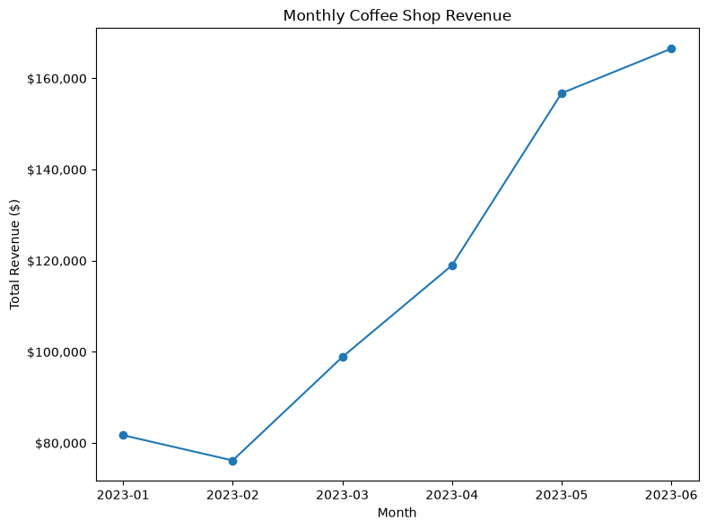
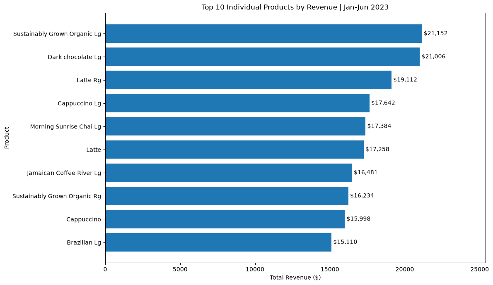

# Coffee Shop Sales Analysis

A Python analysis of sales, product performance, and recorded transaction activity at three fictional New York City coffee shops. The project uses Pandas, Matplotlib, and Seaborn to turn transaction records into business findings with explicit limitations.

## Business objective

Identify which products, locations, and time periods contribute most to sales, and explain what the evidence supports about inventory and service planning.

## Results at a glance

| Metric | January-June 2023 |
|---|---:|
| Calculated sales revenue | $698,812.33 |
| Distinct recorded transaction IDs | 149,116 |
| Units sold | 214,470 |
| Average recorded transaction value | $4.69 |
| Stores | 3 |

- February's total revenue fell **6.77%** from January, while revenue per calendar day rose **3.21%**. Comparing totals alone would miss the difference in month length.
- **Sustainably Grown Organic Lg** was the highest-revenue individual product at **$21,151.75**. Coffee and Tea together generated **66.74%** of revenue.
- **Hell's Kitchen** led store revenue at **$236,511.17**. **Lower Manhattan** had the highest average recorded transaction value at **$4.81**.
- All three stores had their highest six-month hourly transaction total in the **10:00-10:59 AM** bucket. Activity fell at 11 AM, followed by differing afternoon patterns.
- Saturday moved from last in total revenue to **third in revenue per observed day**, because the period contained 25 Saturdays and 26 of each other weekday. Its daily average was practically tied with Thursday's.

Read the [executive summary](reports/executive_summary.md) for recommendations and limitations.

## Analysis and visualizations

Run the notebooks in this order. Each notebook also runs independently from a fresh kernel.

1. [Data exploration](notebook/01_exploration.ipynb): structure, missing values, duplicate IDs, quantities, prices, labels, and dates/times.
2. [Sales analysis](notebook/02_sales_analysis.ipynb): revenue, transactions, average transaction value, product rankings, monthly trends, weekday normalization, and hourly patterns.
3. [Visualization](notebook/03_visualization.ipynb): monthly revenue, revenue by store, top 10 individual products, hourly transactions by store, and product category revenue share.

### Monthly revenue



### Top 10 individual products



## Data and metric definitions

**Source:** [Maven Analytics - Coffee Shop Sales](https://mavenanalytics.io/data-playground/coffee-shop-sales). The supplied workbook is `data/Coffee Shop Sales.xlsx`, sheet `Transactions`. Dataset usage terms belong to the original provider.

The workbook contains **149,116 rows and 11 original columns**, covering **January 1-June 30, 2023**. Each row has a unique recorded `transaction_id`. The analysis uses the supplied data without changing recorded prices or quantities.

| Metric | Definition |
|---|---|
| Line revenue | `transaction_qty * unit_price` |
| Total revenue | Sum of line revenue; reported in the dataset's dollar units |
| Transactions | Count of distinct `transaction_id` values |
| Units | Sum of `transaction_qty` |
| Average recorded transaction value | Total revenue / distinct transaction IDs |
| Monthly revenue per calendar day | Monthly revenue / calendar days in that month |
| Weekday revenue per observed day | Revenue for a weekday / distinct dates for that weekday |
| Hourly transaction count | Distinct transaction IDs in an hour-of-day bucket, accumulated across all six months |
| Individual product | `product_detail`; descriptions map one-to-one with product IDs in this workbook |

## Reproduce the analysis

Tested with **Python 3.12.13**; exact direct dependency versions are listed in [requirements.txt](requirements.txt).

From the repository root:

```bash
python3 -m venv .venv
source .venv/bin/activate
python -m pip install -r requirements.txt
```

Open the repository in VS Code with its Python and Jupyter extensions, open a notebook, and choose the `.venv` Python interpreter as its kernel. Restart the kernel and run all cells from top to bottom. Data loading supports the repository root and folders inside it, including `notebook/`.

To regenerate the independent checks and execute each notebook in a separate fresh kernel:

```bash
python audit/verify_dataset.py
python audit/run_clean_kernels.py
```

The first command checks the workbook using Decimal-based revenue calculations and regenerates reference tables. The second checks notebook outputs against those references, writes executed copies to `audit/executed/`, refreshes chart images, and reports failures with a nonzero exit code. To also save successful fresh outputs into the original notebooks, use `python audit/run_clean_kernels.py --write-notebooks`.

## Interpretation limits

- This is a fictional business dataset. Findings describe this six-month period and do not establish causes or annual seasonality.
- Revenue calculated from quantities and recorded prices is not profit. Costs, margins, refunds, discounts, and tax treatment are not separately established.
- Distinct transaction IDs do not establish complete customer baskets through a separate receipt identifier. Customer-level retention and beverage/bakery co-purchases cannot be validated here.
- Confirmed operating schedules, staffing levels, service times, and customer wait times are absent. Different dates with sales in an hourly bucket may reflect schedules or incomplete capture; transaction totals alone do not establish staffing requirements.
- Recorded price variation across 15 products was retained. It requires business context before being classified as an error.
- Weekday averages pool a period with substantial revenue growth and should not be interpreted as a causal weekday effect.

## Project files

```text
data/                         Original workbook
notebook/                     Three analysis notebooks
reports/executive_summary.md  Management-facing findings and recommendations
audit/                        Independent references, checks, executed copies, and charts
requirements.txt              Tested direct dependencies
```

The [initial audit](audit/PORTFOLIO_AUDIT.md) is a historical review of the earlier version. Its original issue descriptions are retained for context; the current notebooks and executive summary contain the corrected findings. See [audit notes](audit/README.md) for the verification workflow.
